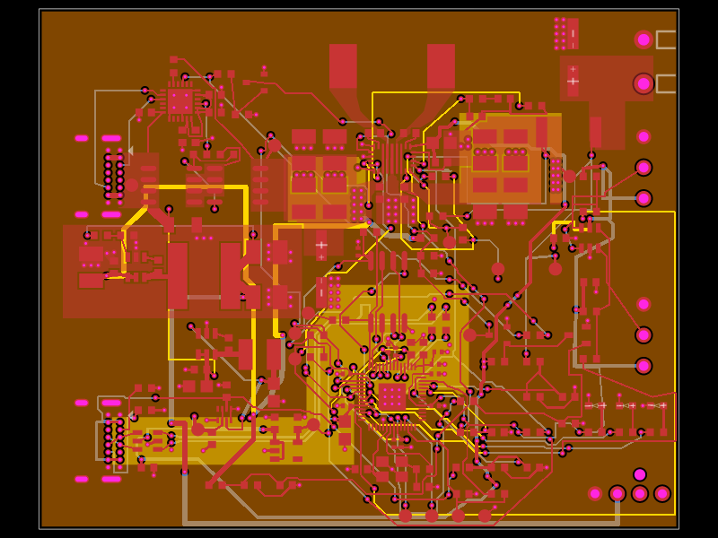

# USB-C PD Peltier driver

An editable tscircuit PCB based on [0hmX/dual-usb-peltier-assembly](https://tscircuit.com/0hmX/dual-usb-peltier-assembly), release **0.4.12**. The default entrypoint displays the PCB itself. The reference's routed copper, supplier footprints, firmware, nine schematic sheets, and optional accessory assembly are retained.

Supplier parts are imported with the **TSCircuit CLI** using `tsci import C… --jlcpcb --use-exact-footprint`. The import audit in [`docs/component-imports.json`](docs/component-imports.json) records the exact commands and source hashes. The active wrappers preserve the reference's pin semantics and documented manufacturing corrections. Schematic placement is refined for closer capacitor banks, compact IC symbols, and readable annotations.



Review the [PCB SVG](docs/previews/pcb.svg), [all nine schematic sheets](docs/previews/all-sheets.svg), or [individual sheet previews](docs/previews/schematics). The [validation record](VALIDATION.md) lists the remaining placement advisories and routing warnings.

## Design

| Item | Specification |
| --- | --- |
| PCB | 72.5 × 59 mm, four layers, nominal 1.6 mm |
| PD POWER | USB-C, CYPD3177 sink controller; 20 V / 5 A target contract |
| USB PROGRAM | Separate USB-C port for RP2040 firmware and serial commands |
| TEC output | TPS55289 buck-boost with programmable voltage/current limits |
| Output settings | 2.1–15 V, 0.5–6 A, maximum configured V × I of 72 W |
| Control | RP2040, 12 MHz crystal, 16 MiB QSPI flash |
| Sensors | Two 3.3 V DS18B20 probe connections: HOT and COLD |
| Fan | Fixed 12 V supply, 0.5 A design budget, 3/4-pin PC fan header |
| Status | POWER, RUN and FAULT LEDs; SWD and other exposed debug pads |

These are the reference design's targets, not measured performance. Temperature sensing reports measurements; the included firmware does not implement closed-loop temperature control. The TEC output has fixed polarity.

## Open and edit

```sh
git clone https://github.com/rushabhcodes/simple-USB-C-PD-peltier-driver.git
cd simple-USB-C-PD-peltier-driver
bun install --frozen-lockfile
bun run dev
```

The local `tsci` executable is pinned through the project dependency and lockfile. Use the **PCB**, **Schematic**, and **3D** tabs in the local viewer. The schematic sheet selector divides the design into PD input, TEC conversion, logic supplies, MCU signals, MCU power, monitoring, debug, fan, and probes.

Start with [`index.circuit.tsx`](index.circuit.tsx), which renders [`src/board/general-pd.tsx`](src/board/general-pd.tsx). The smaller files in `src/board/` contain each functional block. `imports/` and `src/parts/` contain the actual footprints and pin maps. [`assembly.tsx`](assembly.tsx) retains the reference's optional Peltier, fan, probe, and cable visualization; open it with `bun run dev assembly.tsx`.

Saved routing is in [`src/board/routing-data.json`](src/board/routing-data.json). After changing component order or logical connections, run `bun run routing:rebind` and review/reroute the affected copper; rebinding updates associations and does not move traces.

## Validate and build

```sh
bun run typecheck
bun run check:netlist
bun run check:schematic
bun run check:placement
bun run build --disable-parts-engine --pcb-png --schematic-png
bun run export:schematics
bun run check:shorts
bun test ./tests
```

Build artifacts are written to `dist/index/`. Individual sheet SVG/PNG previews and an all-sheet SVG are written to `dist/schematics/`. `--disable-parts-engine` uses the committed supplier parts without querying live stock metadata. The retained tests check electrical connectivity, saved copper, component pin maps, schematic separation, and accessory models. They do not replace hardware qualification.

The current build, netlist, schematic placement, Gerber short check, and 50 retained tests pass. The PCB placement analyzer reports four resistor-orientation advisories and exits nonzero; native placement DRC reports zero errors and zero warnings. Routing width/style warnings are also retained. See [`VALIDATION.md`](VALIDATION.md) for the exact results and limits.

## Wiring and fabrication

- Use a 100 W USB-C PD supply and a 5 A electronically marked cable for the reference's full power target.
- `J_TEC`: pin 1 = TEC positive; pin 2 = ground. Install the Peltier's heatsink and clamping before operation.
- HOT/COLD probes: use the schematic pin map for 3V3, DATA, and GND.
- The original board omits silkscreen. Identify connections and polarity from the schematic and assembly guide.
- Firmware setup and USB commands are in [`firmware/README.md`](firmware/README.md).
- The inherited layout requires the stackup, copper weights, and filled/capped exposed-pad vias described in [`docs/pcb-fabrication.md`](docs/pcb-fabrication.md). Bench qualification remains required before manufacturing release.

## Reference and license

Adapted from [0hmX/usb-c-peltier-board](https://github.com/0hmX/usb-c-peltier-board/tree/87fa5809a7254b2ae2d7efe53fcedd53276361bb), commit `87fa5809a7254b2ae2d7efe53fcedd53276361bb`, corresponding to the supplied tscircuit release. Original source copyright © 2026 0hmX, under the [MIT license](LICENSE). See [`REFERENCE.md`](REFERENCE.md) for the adaptation details and [`docs/general-pd-driver.md`](docs/general-pd-driver.md) for the original design notes and component datasheets.

The optional assembly includes manufacturer CAD from Noctua with its [bundled usage terms](src/assembly/assets/Noctua-CAD-README.txt).
