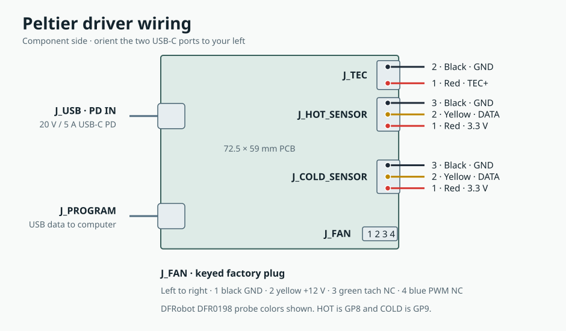

# Bench assembly

This build uses one Same Sky CP60440, two DFRobot DFR0198 probes and one Noctua NF-A8 PWM. The heatsink, cold plate, clamp and inlet duct form an open-bench thermal stack. Start with the commissioning limits below and measure the fixture before increasing power. The board's fabrication release conditions are in the [JLCPCB review](pcb-fabrication.md#jlcpcb-cam-review).

## Parts to buy

| Qty | Part | Where to buy |
| ---: | --- | --- |
| 1 | Same Sky **CP60440**, sealed 40 × 40 × 4.0 mm TEC, two 20 AWG leads about 100 mm long | [DigiKey India 102-1678-ND](https://www.digikey.in/en/products/detail/same-sky-formerly-cui-devices/CP60440/1747370) |
| 2 | DFRobot **DFR0198**, powered DS18B20, Ø6 × 35 mm stainless tube and roughly 0.9 m of cable | [DigiKey India 1738-1311-ND](https://www.digikey.in/en/products/detail/dfrobot/DFR0198/7597054) · [Mouser India 426-DFR0198](https://www.mouser.in/en/ProductDetail/DFRobot/DFR0198) |
| 1 | Fischer Elektronik **SK 595 100 AL**, 120 × 100 × 60 mm heatsink with 9 mm base | [DigiKey India 5496-SK595100AL-ND](https://www.digikey.in/en/products/detail/fischer-elektronik/SK-595-100-AL/25828759) |
| 1 | Noctua **NF-A8 PWM**, 12 V beige/brown version, four-pin plug, 0.08 A max | [Amazon India B00NEMG62M](https://www.amazon.in/dp/B00NEMG62M) · [Noctua retailers](https://www.noctua.at/en/products/nf-a8-pwm/buy) |
| 1 | ARCTIC **MX-4 4 g**, ACTCP00002B thermal paste | [TLG Gaming India](https://tlggaming.com/arctic-mx-4-4g) |
| 1 | ASUS **AC100-03**, India SKU **90XB09SN-BPW020**, 20 V / 5 A from USB-C1 when used alone | [ASUS India](https://www.asus.com/in/accessories/adapters-and-chargers/asus-adapters-and-chargers/asus-100w-usb-c-gan-charger/where-to-buy/) |
| 2 | Cable Matters **201440**, 1 m USB-C to USB-C, 5 A e-marked, USB 2.0 data | [Cable Matters](https://www.cablematters.com/pc-1532-123-usb-c-20-charging-cable-with-240w-power-delivery.aspx) |
| As needed | Red, yellow and black **22 AWG stranded** pigtails and heat-shrink for fine probe leads | [Adafruit 3175 wire set](https://www.adafruit.com/product/3175) |

Make one cold plate from **80 × 76 × 10 mm 6061-T6 aluminium** and one duct from the exported **fan-duct.stl**, printed flange-down in ASA. For the TEC clamp use two **M4 × 20 mm A2 stainless ISO 4762 socket screws** and two **M4 DIN 125 A flat washers** (4.3 × 9 × 0.8 mm). For the fan use four **M4 × 40 mm screws**, M4 flat washers and M4 locknuts. Keep the fan's anti-vibration pads fitted. The bench also needs insulating PCB supports, probe and harness strain relief, and supports that raise the cold plate enough to clear the screw heads. [M4 × 20 mm screws](https://xbotics.in/product/m4-x-20mm-hex-socket-head-screw-stainless-steel-304/) · [M4 × 40 mm screws](https://in.rsdelivers.com/product/rs-pro/rs-pro-plain-stainless-steel-hex-socket-cap-screw/0293347)

Both left-edge ports use the 5 A GCT **USB4110-GF-A**. The PCB parts list gives the exact JLCPCB SKUs and catalog links for all fitted board parts. [JLCPCB C5143397](https://jlcpcb.com/partdetail/5762033-USB4110_GFA/C5143397) · [DigiKey India](https://www.digikey.in/en/products/detail/gct/USB4110-GF-A/10384548) · [PCB parts list](component-sourcing.csv)

The CP60440 drawing gives 40 ± 0.3 × 40 ± 0.3 × 4.0 ± 0.1 mm and identifies the **printed face as cold**. It specifies red positive and black negative. DFRobot's documentation gives red VCC, yellow DATA and black GND. Its Wiki lists a 90 cm cable and its product page describes 95 cm. Measure the delivered leads before fixing the bench layout. [Same Sky CP60 datasheet](https://www.sameskydevices.com/product/resource/cp60.pdf) · [DFRobot probe specifications](https://wiki.dfrobot.com/dfr0198) · [Noctua fan specifications](https://www.noctua.at/en/products/nf-a8-pwm/specifications)

## Identify and wire the board

Orient the PCB **component side up, USB-C ports at left**. On the right edge the terminal blocks run from top to bottom as **TEC, HOT, COLD**. Locate pins on the PCB before inserting wires. Use continuity to confirm the GND screws against the corresponding copper ground pad while the board is unpowered.



| Board connector | Pin order in this view | Attach |
| --- | --- | --- |
| **J_TEC** | Lower **1** · TEC_POS, upper **2** · GND | CP60440 red **+** to 1, black **−** to 2 |
| **J_HOT_SENSOR** | Lower **1** · 3.3 V, middle **2** · DATA, upper **3** · GND | HOT probe red to 1, yellow to 2, black to 3. DATA reaches RP2040 GP8. |
| **J_COLD_SENSOR** | Lower **1** · 3.3 V, middle **2** · DATA, upper **3** · GND | COLD probe red to 1, yellow to 2, black to 3. DATA reaches RP2040 GP9. |
| **J_FAN** | Left to right **1** GND, **2** +12 V, **3** tach NC, **4** PWM NC | Seat the Noctua factory keyed plug. Leads are black, yellow, green, blue respectively. |
| **J_USB** | Upper USB-C on the left | Connect the PD cable from ASUS USB-C1. Leave the charger's other outputs free. |
| **J_PROGRAM** | Lower USB-C on the left | Connect the second cable to a computer's USB-C data port for configuration. |

1. Disconnect both USB cables. Label the probes HOT and COLD, then trim their jackets only as needed at the board end. Keep one externally powered probe on each port. The PCB already has the two 4.7 kΩ pull-ups.
2. Keep the CP60440 factory 20 AWG leads. The KF301 terminal takes 22–14 AWG with 4.5–5.0 mm of strip length. Trim excess exposed conductor, seat each lead fully and tug-test after tightening. The fixture model places the TEC center 103.5 mm to the right of the J_TEC pin column and 1 mm above its midpoint. This leaves slack in the nominal 100 mm leads when the leads exit toward the board.
3. The XY302V terminals take 26–16 AWG. If a probe conductor is finer or its gauge is uncertain, splice on a matching-color 22 AWG stranded pigtail, insulate each joint separately with heat-shrink and strain-relieve the jacket. Keep the screw-clamped section free of added solder. Check that each terminal grips metal and that no strand protrudes.
4. Plug the fan directly into J_FAN. The 12 V fan starts when PD qualifies and continues running when TEC output stops. Fit the Noctua extension supplied with the fan if the factory lead would pull tight. [KEFA terminal drawing](https://www.technobotsonline.com/index.php?attachment_id=497&dispatch=attachments.getfile) · [XINLAIYA terminal specifications](https://www.xinyaelectronic.com/product/xy302v-35) · [Noctua PWM wiring](https://cdn.noctua.at/media/Noctua_PWM_specifications_white_paper.pdf)

## Machine and assemble the thermal stack

Dimensions are in millimetres. Center the TEC on both contact faces. For machining, **X** runs across the 120 mm heatsink width, **Y** runs along the 100 mm fins, and **+X** points away from the PCB. Put the fan at the **+Y** fin end. Use a flat, deburred contact surface on each plate. The manufacturer's mounting guide targets flatness better than 0.02 mm over the contact area. [Fischer SK 595 profile drawing](https://www.tme.eu/Document/23cee837e3b77859cb22816be07c871e/SK5951000SA.pdf) · [Same Sky mounting guide](https://www.sameskydevices.com/catalog/resource/peltier-app-note.pdf)

| Feature | Location and size |
| --- | --- |
| Heatsink clamp holes | From the flat underside, blind tap **M4 × 0.7** at (X, Y) = **(−27, 0)** and **(+27, 0)**. Provide at least 5.5 mm full thread, with maximum 8 mm total drilling depth including the tip in the 9 mm base. |
| Cold plate clamp holes | Two **Ø4.5 mm through holes** at the same (X, Y) coordinates. Insert the screws and washers from below. Confirm thread engagement of about 5 mm and clearance to the blind-hole bottoms in a dry fit. |
| HOT probe bore | From the heatsink's **+X side**, centered at **Y = +12** and **4.5 mm above the flat underside**. Bore **Ø6.2 mm × 36 mm full diameter** toward −X, with room for the drill point. |
| COLD probe bore | From the cold plate's **−Y side**, centered at **X = 0** and **5 mm below the top contact face**. Bore **Ø6.2 mm × 36 mm full diameter** toward +Y. |
| Fan mount | **71.5 × 71.5 mm** pattern on the printed flange. The rectangular duct end slips over the first **6 mm** of the +Y inlet. Check the fit on the delivered extrusion before securing it. |

1. Dry-fit both plates, the TEC and the screws. Point the factory lead exit toward the PCB. The **printed cold face goes against the cold plate** and the opposite face against the heatsink. The plates must sit parallel with full ceramic contact and the leads clear of screw heads and plate edges.
2. Clean the four mating faces, then spread a thin, continuous film of MX-4 on both TEC interfaces. Seat the plates without twisting the leads. Start both screws by hand and tighten in alternating small increments while holding the stack square. Same Sky gives **200–300 N total clamp load** for a 40 mm module and an approximate **100 N per M4 screw at 0.10 N·m** in its example. Use a low-range torque driver and verify the load for the actual hardware and friction. Recheck the clamp after 30–60 minutes. [Same Sky mounting guide](https://www.sameskydevices.com/catalog/resource/peltier-app-note.pdf)
3. Put a light film of paste on each stainless probe and seat it to the cable shoulder in its bore. Secure each jacket independently so it cannot pull the sensor out. Keep the HOT cable away from the airflow path and the COLD cable clear of condensate. The probes read plate temperature near the TEC.
4. Bolt the fan to the duct with the **airflow arrow on the frame pointing into the fins**. Fit the duct to the +Y inlet, secure it and support the fan so its weight does not pull on the collar. Keep the opposite fin end open and all cables clear of the rotor. Place the PCB on insulated supports and keep it away from the cold plate and any condensation.

## First power-up

1. With the TEC disconnected, connect **PROGRAM only**. On a blank board, copy `general_pd.uf2` to the RPI-RP2 drive, then wait for the USB serial port. Send `STATUS` with a newline or run the host tool's `status` command. Both probes should report plausible ambient values and **hot_valid=1** and **cold_valid=1** after conversion. Warm each probe in turn before installation if needed to confirm the channels. [Firmware build and programming](../firmware/README.md#build)
2. Check the saved-profile flag before connecting the TEC. A saved profile starts automatically about one second after PD qualifies. For a new board with **saved=0**, leave it unsaved during commissioning. On a used board, use PROGRAM with the TEC disconnected to replace any unknown profile with **3.0 V / 1.0 A** using the host tool. Treat that saved setting as automatic on later PD attachment.
3. Disconnect power, wire the TEC and fan, then reconnect PROGRAM. On the unsaved board, open its USB serial terminal and send the following commands. They set a temporary ceiling and leave the output off.

   ```text
   STOP
   SET 3000 1000
   STATUS
   ```

4. Connect PD IN. Verify that the fan spins, air travels through the fins, and STATUS reports qualified PD near 20 V. On the unsaved board send **RUN**. Check that the cold plate cools relative to the heatsink and that the current stays near or below the 1 A setting. Send **STOP** if airflow drops, a probe becomes invalid, temperatures move in the wrong direction, condensation reaches wiring, or the HOT reading reaches **50 °C** during this initial test. Remove PD power if the stop command cannot reach the board.
5. The temperature readings are telemetry. Firmware does not turn the TEC off on overtemperature or loss of a probe. Verify hot-side temperature, current and airflow with the intended load before raising the limit. The 72 W board setting is a design ceiling and carries no measured rating for this fixture.

## 3D files

Run **bun run build:assembly**. Open **dist/assembly/assembly.html** for the installed view and select **Explode stack** to inspect the TEC, clamp and probes. The export also writes **assembly.glb**, **assembly.png**, **wiring.svg**, **fan-duct.stl** and **provenance.json**. The GLB contains the routed PCB and its fitted part meshes, the Noctua manufacturer model, and drawing-derived models for the thermal stack. Simplified fin detail and harness bends illustrate assembly. Check purchased parts and the printed collar before machining or loading the fixture.
