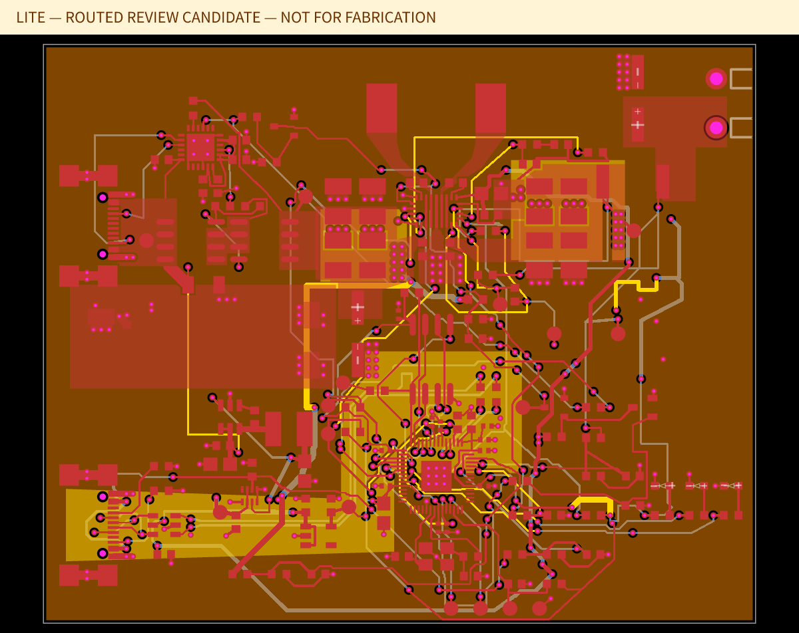
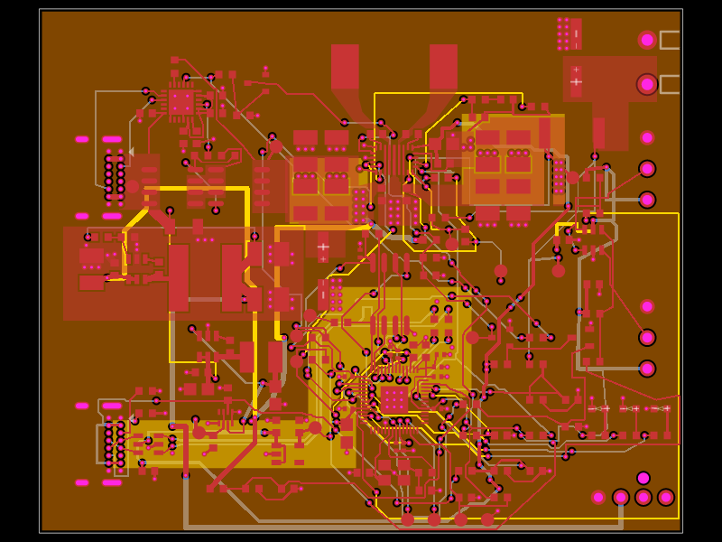
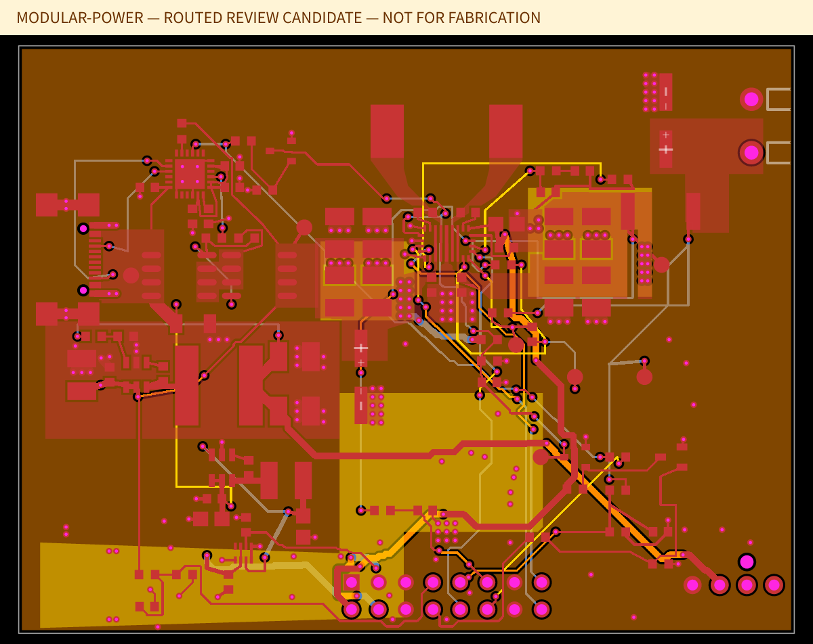
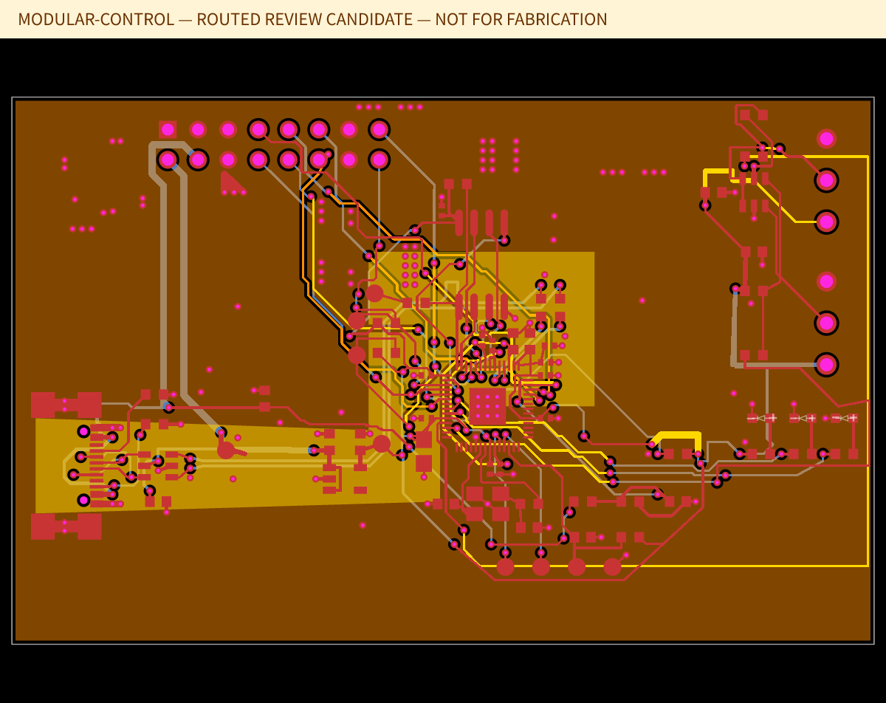

# Three Peltier driver product designs

The design family offers a lower-BOM OEM board, the existing integrated board,
and a serviceable two-board system. All retain the reference CC/CV controller,
RP2040 pin mapping, reverse-blocked PROGRAM power and fixed TEC polarity.

**Design stage:** All four PCBs have routed copper checked against fresh source,
physical connectivity, native DRC and fabrication geometry. Standard retains its
original layout; Lite and Modular have variant-specific copper. None has completed
electrical, thermal or mechanical bench qualification. The 72 W TEC setting is a
configuration ceiling, not a measured continuous-power rating. The firmware has
temperature telemetry but no thermostat or polarity reversal.

## Product and selling-price targets

The following are **provisional planning targets**, pending the user's price
range, currency and sales market. They are not customer-approved prices,
supplier quotations or evidence of profit. The comparison assumes **100 units**,
direct sale and **assembled PCB(s), including Modular's internal harness**. TEC,
fan, probes, heatsink, enclosure, PSU, external cables and sales tax are excluded
from that sale scope.

| Product | Physical PCBs | Size, mm | Purchased placements | Included features | Provisional USD selling target | Maximum landed COGS at 50% gross margin |
|---|---:|---|---:|---|---:|---:|
| Lite | 1 | 72.5 × 59 | 115 | CC/CV, USB configuration, recovery pads; OEM supplies cooling/sensing | $59–79 | $29.50–39.50 |
| Standard | 1 | 72.5 × 59 | 134 | Existing CC/CV board, 12 V fan supply, two powered probe interfaces | $89–119 | $44.50–59.50 |
| Modular | 2 | Power 72.5 × 55; controller 72.5 × 46 | 137 across both boards | Standard features, separated controller and power PCBs | $119–159 | $59.50–79.50 |

The cost ceilings correspond to the lower and upper selling targets respectively.
Landed COGS must include materials, fabrication, assembly **for each PCB**, the
modular harness, programming/test, scrap allowance and inbound freight. Supplier
and PCBA quotes are still missing, so actual cost and target feasibility are
**unknown**. Outbound shipping, sales fees, warranty overhead, engineering/tooling,
tax and channel margin need a separate business plan; gross margin is not net
profit. Change the explicit assumptions in [`designs/products.json`](../designs/products.json).

### Lite — simpler OEM integration

The fan buck circuit (10 placements) and both probe interfaces (9 placements)
are removed. The RP2040's GPIO8/9 are marked NC. USB programming, flash, clock,
CC/CV, ADC monitoring, PD qualification, status and the hardware shutdown clamp
remain. The existing firmware can report missing probes; there is no new lower
power limit or closed-loop cooling feature. The outline is unchanged: the claimed
saving is 19 purchased placements, **not** a measured dollar or PCB-area saving.
An OEM must provide suitable cooling independently of the removed fan supply.



### Standard — integrated reference

The original board and firmware remain the baseline. Its original routed
geometry and tests continue to apply. This is the most mature starting point for
an integrated product, with manufacturing-process and bench qualification still
required. See [the baseline validation](../VALIDATION.md).



### Modular — separate power and controller boards

The power PCB retains PD negotiation, back-to-back FETs, the TEC switching loop,
shunt/Kelvin sensing, fan regulator, 5 V auxiliary regulator and power mux. Both
shutdown transistors, their bias resistors, and the scaled ADC front ends stay
on this PCB. The extra `C_LINK_PROGRAM` provides local bypass at the mux's
harness-fed PROGRAM input.

The controller PCB carries PROGRAM USB, its CC/ESD/input capacitor, 3.3 V LDO,
RP2040/flash/crystal, probe ports, fault pull-up, status and recovery points.
USB differential signals, QSPI and the crystal remain local. Both module outlines
are individually smaller than Standard, but their combined board area is about
73.2 cm² versus 42.8 cm² for Standard. Extra board area, connectors, test and
harness assembly make this a serviceability option rather than a cost saving.





## Modular electrical interface

`J_LINK` on each board is a **provisional 2×8, 2.54 mm through-hole footprint**.
The cable connects like-numbered pins. The render is not a selected keyed
connector: the final MPN, housing, pin-1/key orientation, current/voltage ratings,
contact resistance and cable assembly require datasheet and mating-part review.
Do not treat a warning about its missing MPN as resolved by marking it DNP.

| Pin | Net | Direction / purpose |
|---:|---|---|
| 1 | GND | Shared return |
| 2 | LOGIC_5V | Power → controller, reverse-blocked logic/bias supply |
| 3 | PROGRAM_VBUS | Controller → power, PROGRAM USB 5 V into the power mux |
| 4 | GND | Shared return |
| 5 | MCU_DRIVER_PERMISSION | Controller → power, active HIGH permission through local 1 kΩ gate resistor |
| 6 | DRIVER_FAULT | Power → controller, converter fault, controller-side pull-up |
| 7 | PD_FAULT_SENSE | Power → controller, series-protected PD fault indication |
| 8 | GND | Signal return |
| 9 | I2C_SCL | Shared 3.3 V control bus; controller pull-up |
| 10 | I2C_SDA | Shared 3.3 V control bus; controller pull-up |
| 11 | GND | Signal return |
| 12 | OUTPUT_CURRENT_ADC | Power → controller, existing filtered current-monitor signal |
| 13 | OUTPUT_VOLTAGE_ADC | Power → controller, existing 100 kΩ / 20 kΩ divider output |
| 14 | INPUT_VOLTAGE_ADC | Power → controller, existing 150 kΩ / 22 kΩ divider output |
| 15–16 | GND | Shared returns |

No raw PD, TEC output, switching node, Kelvin shunt connection or converter EN
crosses this harness. Nominal signal levels are 3.3 V; pins 2/3 are 5 V rails.
Use a short internal harness (initial planning limit 100 mm) and an initial
0.35 A budget on each 5 V rail. Those are design constraints, not measured cable
capability or implemented current limits. Validate I2C timing, ADC noise,
ground-return error and power sequencing after selecting the connector/cable.
The design is not specified for live hot-plugging.

On complete controller disconnect, the local 100 kΩ gate pulldown, 47 kΩ
bias and two-transistor clamp retain the original default-off topology while
the power-side bias exists. The graph review verifies that topology and detects
an open permission wire; actual disconnect/brownout/transient behaviour still
requires bench testing. This is not a claim of protection against every
individual conductor fault.

## Build and inspect the candidates

```sh
bun run designs:build
bun run designs:route-check
bun run designs:review
bun test ./tests
```

`designs:build` compiles fresh source for Lite and both Modular boards, exports
Circuit JSON, BOM JSON, routed PCB SVG/PNG and multi-sheet schematic
SVG, and writes `dist/product-designs/validation.json`. Parts-engine lookups are
disabled deliberately for this reproducible design study; all supplier stock
and cost information needs a new quote. Standard continues to use the existing
`bun run build` and `bun run build:preview` workflows.

The builder checks every original pin through the explicit cable, actual copper
connectivity, native DRC, clearances, thermal arrays, clock routing and the
converter's power corridors and Kelvin branches. A failed check makes it exit
nonzero. Missing connector MPNs remain reported warnings and open release gates.
`bun run designs:build --fabrication` intentionally refuses to export unqualified
hardware. The previews above show the routed review candidates.

Editable entrypoints:

- [Lite](../designs/lite.circuit.tsx)
- [Standard](../designs/standard.circuit.tsx)
- [Modular power](../designs/modular-power.circuit.tsx)
- [Modular controller](../designs/modular-control.circuit.tsx)

Read [the review log](design-review.md) for all findings, fixes, failed checks,
re-review outcomes and open issues. The [routing follow-up](routing-review.md)
records three further review cycles and each board's measured routing checks.
Saved copper in `designs/copper/` belongs to its exact source variant; it must be
rebound and reviewed after source changes. Connector selection, mechanical checks,
PCBA quotations and hardware qualification remain required before manufacturing or sale.
